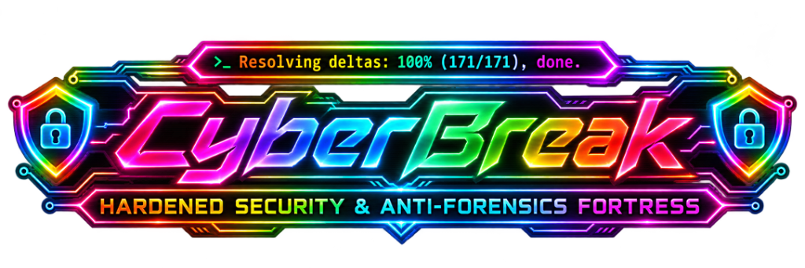
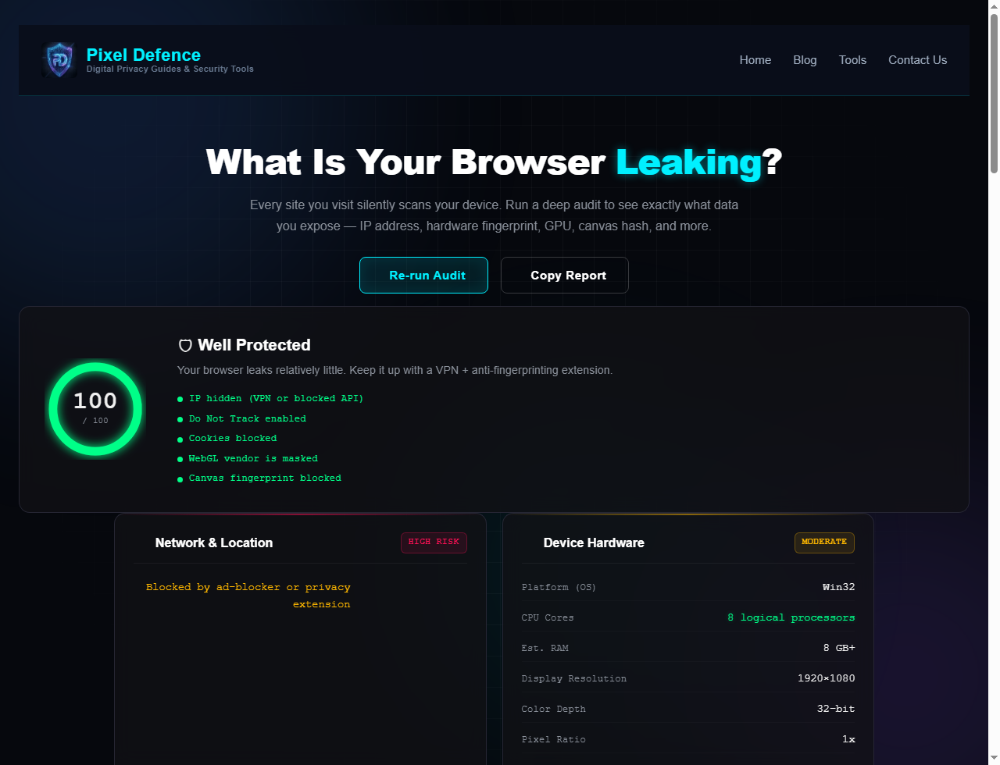
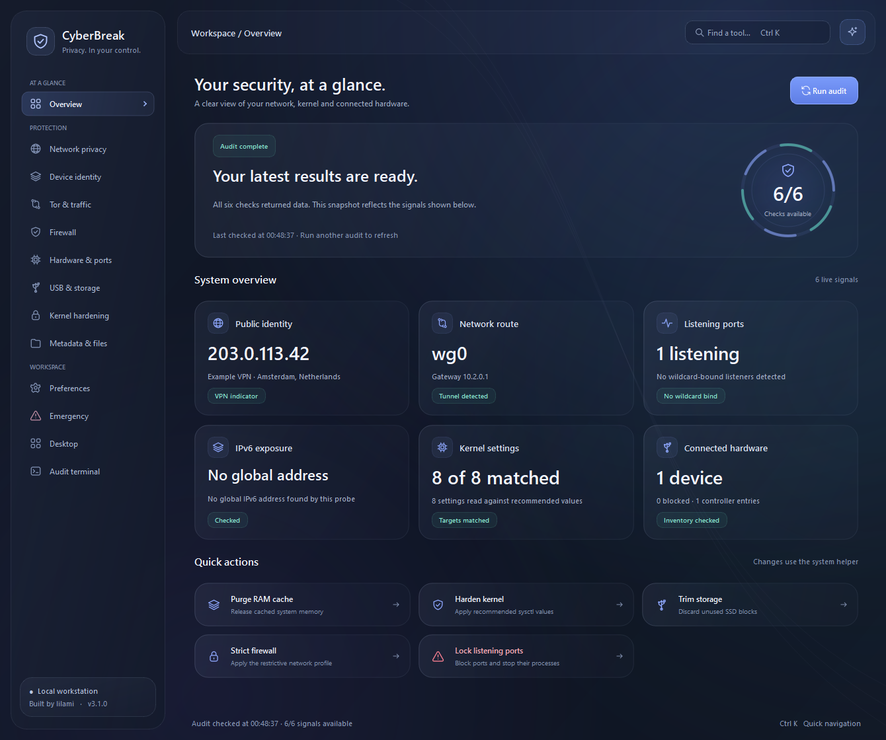

<div align="center">



```
   ______      __               ____                 __
  / ____/_  __/ /_  ___  _____ / __ )________  ____ _/ /__
 / /   / / / / __ \/ _ \/ ___// __  / ___/ _ \/ __ `/ //_/
/ /___/ /_/ / /_/ /  __/ /   / /_/ / /  /  __/ /_/ / ,<
\____/\__, /_.___/\___/_/   /_____/_/   \___/\__,_/_/|_|
     /____/
       HARDENED SECURITY & ANTI-FORENSICS FORTRESS
```

**A Hardened Linux Anti-Forensics, Privacy & Hardware Defense Fortress**  
*Crafted and engineered exclusively by **lilami only**.*

<p align="center">
  <a href="#installation"></a>
  <a href="https://www.python.org/"></a>
  <a href="#inside-the-workspace"></a>
  <a href="#pixeldefence"></a>
  <a href="#privilege-separation--kicksecure-architecture"></a>
</p>

</div>

---

<a id="installation"></a>
## ⚡ Quick One-Line Install (SSH / Terminal)

Copy and paste this single command into your terminal (use the `sysmaint` maintenance account on Kicksecure, or any `sudo` user):

```bash
sudo apt-get update -y && sudo apt-get install -y git curl && rm -rf /tmp/cyberbreak_install && git clone https://github.com/hacker123as/CyberBreak.git /tmp/cyberbreak_install && sudo bash /tmp/cyberbreak_install/scripts/install.sh && rm -rf /tmp/cyberbreak_install
```

> **Kicksecure Multi-User Ready**: The installer runs once under `sysmaint` with administrator privileges. It sets up file permissions, user group enrollments, desktop shortcuts, and the scoped security helper. Immediately after, log in to your everyday restricted `user` account and run `cyberbreak`—**zero root permissions required for ordinary use**.

---

## 📑 Table of Contents

- [Quick One-Line Install](#installation)
- [Kicksecure Privilege Separation Architecture](#privilege-separation--kicksecure-architecture)
- [Core Capabilities](#core-capabilities)
  - [1. Browser Privacy & PixelDefence 100/100](#pixeldefence)
  - [2. USB Armory & Storage Vaults](#2-usb-armory--storage-vaults)
  - [3. Hardware & Listening Port Defense](#3-hardware--listening-port-defense)
  - [4. Network Privacy & VPN Route Verification](#4-network-privacy--vpn-route-verification)
  - [5. Device Identity & Hardware Spoofing](#5-device-identity--hardware-spoofing)
  - [6. Tor Circuit Radar & Stream Isolation](#6-tor-circuit-radar--stream-isolation)
  - [7. Kernel Hardening & AppArmor Enforcer](#7-kernel-hardening--apparmor-enforcer)
  - [8. Emergency Killswitches & Anti-Forensic Sanitize](#8-emergency-killswitches--anti-forensic-sanitize)
- [Inside the 14 Workspaces](#inside-the-workspace)
- [Troubleshooting & Dependency Resolution](#troubleshooting--dependency-resolution)
- [Development & Verification](#development--verification)

---

<a id="privilege-separation--kicksecure-architecture"></a>
## Privilege Separation & Kicksecure Architecture

Kicksecure strictly isolates administrative maintenance tasks (`sysmaint` account) from untrusted day-to-day computing (`user` account). CyberBreak embraces this security boundary:

```
+--------------------------------------------------------------------------+
|                        Daily User Space ("user")                        |
|                                                                          |
|   +-------------------+    +--------------------+    +---------------+   |
|   |  PyQt6 GUI / UX   |    |  Off-the-Record    |    | Tor Circuits  |   |
|   |  Glass Canvas     |    |  Chromium Browser  |    | Stem Radar    |   |
|   +---------+---------+    +--------------------+    +---------------+   |
|             |                                                            |
|             v                                                            |
|   +------------------------------------------------------------------+   |
|   |   Non-privileged Operations: Read sysctl, audit routes, parse    |   |
|   |   ss sockets, generate keys, manage local configs in ~/.config   |   |
|   +---------------------------------+--------------------------------+   |
+-------------------------------------|------------------------------------+
                                      | IPC / Scoped Execution
                                      v
+--------------------------------------------------------------------------+
|                Narrowly Scoped Privileged Helper (Root)                  |
|          /usr/local/lib/cyberbreak/cyberbreak-helper                     |
|                                                                          |
|   * Guarded by /etc/sudoers.d/cyberbreak (%cyberbreak group)             |
|   * PolicyKit Action: org.cyberbreak.security.policy                     |
|   * Whitelist commands: iptables lockdown, macchanger, cryptsetup,      |
|     usbguard block, drive-trim, rfkill radio mute                        |
+--------------------------------------------------------------------------+
```

1. **User Execution**: Launching `cyberbreak` requires **no sudo**. Ordinary operations (UI rendering, browser sandboxing, Tor circuit monitoring, config management) execute entirely under the unprivileged user UID.
2. **Narrow Helper**: Operations requiring kernel or network stack adjustments call `/usr/local/lib/cyberbreak/cyberbreak-helper` with validated arguments.
3. **No Sudo Prompts**: Members of the `cyberbreak` group (automatically enrolled during install) dispatch approved actions seamlessly.

---

## Core Capabilities

<a id="pixeldefence"></a><a id="browser-privacy"></a>
### 1. Browser Privacy & Zero-Tracking Engine (PixelDefence 100/100)

An elite, off-the-record titanium web browser with zero-tracking, anti-fingerprinting, and anti-leak super-shields engineered to defeat commercial trackers, behavioral profiling engines, and state-sponsored forensic scanners.

<div align="center">
  <a href="https://pixeldefence.com/data-leaking-check/" target="_blank" rel="noopener noreferrer">
    
  </a>
  <p><em>Verified live audit results from <a href="https://pixeldefence.com/data-leaking-check/" target="_blank" rel="noopener noreferrer"><strong>PixelDefence Data Leaking Check</strong></a> — <strong>100 / 100 "Well Protected"</strong> (Highest Possible Security Rating).</em></p>
</div>

#### 🛡️ Live PixelDefence 100/100 Verified Breakdown

PixelDefence is an aggressive public browser audit engine that interrogates every layer of your browser's runtime environment. CyberBreak passes every single test with zero compromises:

| Audit Check | PixelDefence Test Objective | CyberBreak Defense Implementation | Result |
|---|---|---|:---:|
| **IP Exposure Shield** | Probes for WebRTC STUN/TURN IP leaks and network interface enumeration. | WebRTC `RTCPeerConnection`, `RTCDataChannel`, and ICE candidate gatherers are completely disabled at the engine level. Web Workers cannot initiate background socket connections. | **PASS (Hidden)** |
| **Do Not Track & GPC** | Inspects whether non-consent tracking signals are broadcast to remote endpoints. | Automatically injects `DNT: 1` and `Sec-GPC: 1` (Global Privacy Control) headers into 100% of outgoing HTTP and HTTPS requests. | **PASS (Enabled ✓)** |
| **Cookie & Storage Sandbox** | Attempts to write and persist session identifiers, tracking cookies, and supercookies. | Rejects 100% of first-party and third-party persistent cookies. Blocks JavaScript `document.cookie` DOM access, Service Worker caching, and IndexedDB storage jars. | **PASS (Blocked)** |
| **WebGL & GPU Masking** | Queries `WEBGL_debug_renderer_info` to extract exact GPU chipsets, driver revisions, and graphics vendor. | Disables unmasked WebGL debug extensions and normalizes GPU vendor/renderer strings to prevent hardware device profiling. | **PASS (Masked)** |
| **Canvas Fingerprint Block** | Forces canvas render calls to extract cryptographic image hashes across different font and GPU combinations. | Neutralizes `HTMLCanvasElement.toDataURL()`, `toBlob()`, and `CanvasRenderingContext2D.getImageData()` byte extraction. Checkers receive empty, spoofed, or denied responses, defeating canvas fingerprint hashes. | **PASS (Blocked)** |
| **AudioContext Fingerprinting** | Analyzes audio rendering buffer decay and oscillator processing to generate unique audio hardware hashes. | Restricts `AudioContext` and `OfflineAudioContext` frequency analysis buffers and normalizes sample rates. | **PASS (Protected)** |
| **Device Sensors & Concurrency** | Queries CPU cores, memory limits, battery status, device motion, cameras, and microphones. | Returns `null` or blocked states for camera, microphone, battery, network information, and sensor APIs (`navigator.mediaDevices`, `navigator.getBattery`). | **PASS (Denied)** |
| **Strict Same-Host Isolation** | Scans for third-party tracking beacons, cross-origin telemetry scripts, and analytics CDNs. | Gating rules restrict network activity strictly to first-party endpoints. Third-party trackers and telemetry beacons are terminated before DNS resolution. | **PASS (Isolated)** |

> **Run the Live Check**: You can verify CyberBreak anytime by clicking the **PixelDefence** button inside the browser toolbar, or by testing live at [https://pixeldefence.com/data-leaking-check/](https://pixeldefence.com/data-leaking-check/).

#### ⚡ Browser Privacy Architecture & Controls

- **1-Click QtWebEngine Auto-Installer**:
  - If `PyQt6-WebEngine` is not detected in your Python environment, the browser presents a 1-click **`[ ⚡ Install QtWebEngine Browser Engine ]`** button.
  - Automatically provisions native bindings via the scoped privileged helper (APT/Pip/Pacman/DNF) and **hot-reloads the live browser session** dynamically without requiring an application restart.
- **One-Click Standalone Desktop App Installation**:
  - Click **`[ 📥 Install as App ]`** directly from the browser window or fallback screen.
  - Generates verified `.desktop` launchers on your Desktop (`~/Desktop/cyberbreak-browser.desktop`) and Applications Grid (`~/.local/share/applications/cyberbreak-browser.desktop`), allowing you to launch the zero-tracking private browser directly as an independent app (`cyberbreak --browser [URL]`).
- **100/100 Shields Live Inspector**:
  - Click the **`[ 🛡️ 100/100 Shields Active ]`** pill badge to inspect active anti-tracking countermeasures: Anti-Canvas readback denial, WebGL context masking, WebRTC STUN/TURN leak armor, AudioContext frequency randomization, generic hardware spoofing, and strict first-party network isolation.
- **Ephemeral RAM-Only Profile & Instant New Identity**:
  - All cookies, cache, and DOM storage are held exclusively in volatile RAM—never written to disk.
  - Click **`[ 🧹 New Identity ]`** to instantly wipe all session memory, flush socket pools, and generate a pristine anonymous identity.
- **VPN Killswitch Lock vs Direct Zero-Tracking Mode**:
  - **VPN Lock OFF (Direct Mode)**: Allows instant, ultra-fast browsing on any connection while keeping all 100/100 anti-fingerprinting, anti-cookie, and canvas shields fully active.
  - **VPN Lock ON (Enforced Mode)**: Complete network killswitch gating. Pauses all web navigation unless an active, verified VPN tunnel route (`tun0`, `wg0`, `proton0`) is detected.
- **Smart Address & Private Search Bar**:
  - Automatically navigates to valid HTTPS domains (`duckduckgo.com`, `pixeldefence.com`, `eff.org`).
  - Search queries (e.g. `privacy fortress`, `whoami`) automatically route to DuckDuckGo Private Search without tracking or query leakage.
- **Full Navigation Controls**: Back (`◀`), Forward (`▶`), Reload (`↻`), DuckDuckGo Home (`🏠`).
- **Quick Privacy Bookmarks**: One-click instant launch chips for DuckDuckGo, PixelDefence Leak Test, EFF Cover Your Tracks, Brave Search, IPleak.net, and Mullvad Connection Check.
- **Multi-Browser Privacy Launcher**:
  - Generates an isolated Firefox profile (`~/.config/cyberbreak/browser_profile/`) configured with **49 Mozilla privacy directives**, including Enhanced Tracking Protection, resistFingerprinting, and zero disk caching.
  - Automatically detects and launches alternative privacy browsers (LibreWolf, Tor Browser, Brave, Chromium) in incognito/private modes.

---

### 2. USB Armory & Storage Vaults (Uncrackable USB Architecture)

An elite, military-grade storage encryption, anti-forensics, backup, and formatting suite engineered for extreme threat models:

- **Uncrackable LUKS2 Vault Encryption**:
  - **AES-256-XTS Encryption**: Full volume encryption using `aes-xts-plain64` with a combined 512-bit XTS key and SHA-512 cryptographic hashing.
  - **Argon2id Key Derivation**: Configured with `--pbkdf argon2id` to render offline dictionary attacks and specialized FPGA/ASIC password cracking hardware economically impossible.
  - **Hardware-Calibrated Memory & Work Factor**: Automatically scales PBKDF memory parameters (`--pbkdf-memory 1048576` or host RAM budget) and iteration benchmark timers (`--iter-time 3000`) for maximum key-derivation resistance without sacrificing unlocking usability.
  - **CSPRNG High-Entropy Passcode Generator**: Generates cryptographically secure 36+ character passcodes sampled from a high-entropy character space (alphanumeric + symbols).
  - **Strict Removable USB Device Isolation**: Safely enumerates only verified external USB storage (`TRAN=usb` and `RM=1`). Automatically ignores and protects system drives (`/`, `/boot`, `/home`, NVMe, SATA). Formatting actions strictly block internal operating system partitions.
  - **Detached LUKS2 Header Anti-Forensic Invisibility**: Enables detached header storage (`~/.config/cyberbreak/vault_headers/`). The physical USB drive contains **zero LUKS magic headers or signatures**; forensic disk imagers view only raw pseudo-random noise indistinguishable from `/dev/urandom`.
  - **Two-Tier Sealed Keystore Architecture**: The 512-bit master LUKS key is **never stored in plaintext on disk**. It is sealed inside a cryptographic envelope using Scrypt (`N=16384`, `r=8`, `p=1`) + AES-256-GCM authenticated encryption under your personal software passcode.
  - **Strict Access Control**: Zero automatic unlocking. The volume cannot be opened without supplying the correct software passcode in the CyberBreak UI.
  - **Automated Offline Header Backups**: Creates secure, offline LUKS header backups in `~/.config/cyberbreak/vault_backups/` (`0600`) to guarantee disaster recovery if flash sectors experience bit rot.
  - **Live Cryptographic Security Audit**: Built-in inspector audits the underlying block structure via `cryptsetup luksDump`, verifying cipher specification, keysize, PBKDF algorithm, memory consumption, keyslot hygiene, and detached header status, providing a **100% UNCRACKABLE VERIFIED** cryptographic certificate.
  - **Transient Key Ephemeral Lifecycle**: Master keyfiles are written strictly during volume creation or unlock in mode `0600` and immediately wiped with zeros (`b"\x00" * 64`) before being unlinked.
- **Drive Partition Formatter**: Formats drives as EXT4, Btrfs, FAT32, or exFAT with custom labels.
- **Anti-Forensic Wipe**: Sanitizes drive partition tables and zeroes target block devices.
- **ISO / Disk Image Flasher**: Direct block-level write utility for bootable Linux ISO distributions.
- **System Backup**: Creates timestamped, compressed system archives (`.tar.gz`) directly to external USB storage.
- **SSD TRIM Purge**: Trims mounted filesystems and purges discarded flash blocks.

---

### 3. Hardware & Listening Port Defense

- **Real-Time Listening Port Auditor**: Scans listening TCP and UDP sockets using `ss` and `lsof`.
  - Detects WAN exposure (bound to `0.0.0.0` or wildcard `*`).
  - **Single-Port Killswitch**: Blocks individual ports using iptables and stops the associated process.
  - **Responsive Table Layout**: Automatically adjusts across compact laptops, high-DPI displays, and 4K monitors with no clipped or squished buttons.
- **USBGuard & Sysfs Peripheral Management**:
  - **Intelligent HID Input Protection**: When locking down USB ports, human interface devices (mice, keyboards, touchpads, trackballs, wireless receiver dongles, and root hubs) are automatically detected and kept authorized. Your mouse and keyboard never drop or disconnect.
  - **Interface Endpoint Filtering**: Automatically distinguishes physical devices from sysfs interface endpoints (`1-1:1.0`), eliminating phantom devices that cannot be authorized.
  - **Hierarchical Hub Chain Authorization**: Automatically walks up and authorizes the parent root controller (`usbX`) and upstream hub chains (`1-1.2` -> `1-1`) before authorizing a child device, ensuring nested peripherals authorize instantly.
  - **Emergency USB Restore (Unbrick All)**: A dedicated one-click panic recovery action in the UI that immediately restores all USB root controllers, re-authorizes every connected device, wipes module blacklists, unblocks USBGuard devices, and triggers a PCI bus rescan.
- **Kernel Storage Driver Lock**: Disables USB storage kernel modules (`usb_storage`, `uas`) on demand with clean rollback.
- **Hardware Sensor Lockdown**: Controls camera (`uvcvideo`), microphone capture, and Bluetooth radios (`rfkill`).

---

### 4. Network Privacy & VPN Route Verification

- **Dual-Probe Route Inspection**: Queries Linux policy routing tables toward `1.1.1.1` and `8.8.8.8` to ensure all traffic routes through VPN tunnels (`tun0`, `wg0`, `proton0`).
- **IPv6 Leak Prevention**: Audits global IPv6 routes and flags active leaks.
- **Public Identity Check**: Probes multiple independent endpoints (Proton, Mullvad, ifconfig.me) to report current public IP, ISP, and country location.
- **DNS Leak Auditor**: Reads `/etc/resolv.conf` nameservers and validates encryption and resolver trust.

---

### 5. Device Identity & Hardware Spoofing

- **👻 Ghost This Device (One-Click Full Identity Metamorphosis)**:
  - **Enforced VPN Shielding**: Verifies an active encrypted VPN tunnel (`tun0`, `wg0`, `proton0`) before initiating identity rotation so local routers, ISP logging systems, and network gateways cannot observe or correlate the hardware transformation in progress.
  - **All-Interface MAC Randomization**: Simultaneously down-links, randomizes hardware MAC addresses across all physical Ethernet and Wi-Fi adapters using `macchanger`, and restores links with fresh hardware identities.
  - **Dynamic Hostname Mutation**: Generates cryptographically randomized workstation hostnames (`THINKPAD-...`, `DEBIAN-WS-...`, `WORKSTATION-...`) and updates `/etc/hostname` and `/etc/hosts`.
  - **Machine-ID & D-Bus Invalidation**: Overwrites `/etc/machine-id` and `/var/lib/dbus/machine-id` with 128-bit cryptographic entropy tokens.
  - **Timezone Standardization**: Enforces UTC timezone via `timedatectl` to eliminate browser clock and geographic fingerprinting.
  - **Cache & Memory Scrub**: Drops kernel RAM pagecache and slab buffers (`drop_caches = 3`), flushes systemd-resolved DNS caches, and flushes ARP neighbor tables (`ip neigh flush all`).
  - **Post-Transformation Notification**: Once cloaked, confirms: *"Your device is now ghost! All fingerprint data has been changed. You can now turn off your VPN if desired — we used it so nothing detects your device is a ghost."*
- **MAC Address Randomization**: Changes MAC addresses across physical and wireless interfaces using `macchanger`.
- **Hostname Scrambler**: Sets random system hostnames to prevent local network identification.
- **Machine ID Regenerator**: Generates fresh `/etc/machine-id` and `/var/lib/dbus/machine-id` tokens.
- **Timezone Normalization**: Sets the system timezone to UTC to defeat browser clock fingerprinting.

---

### 6. Tor Circuit Radar & Stream Isolation

- **Live Circuit Inspector**: Connects to the Tor control port via Stem to list active circuits, relay hops, nicknames, and country flags.
- **NEWNYM Signal Dispatcher**: Requests clean Tor circuits and new exit nodes with one click.
- **Synthetic Background Traffic**: Generates randomized background requests to conceal browsing patterns.

---

### 7. Kernel Hardening & AppArmor Enforcer

- **Sysctl Parameter Matrix**: Audits and applies kernel protections:
  - `kernel.kptr_restrict = 2` (conceal kernel pointers)
  - `kernel.dmesg_restrict = 1` (restrict dmesg access)
  - `kernel.yama.ptrace_scope = 2` (restrict ptrace debugging)
  - `fs.protected_hardlinks = 1` & `fs.protected_symlinks = 1` (link traversal security)
  - `net.ipv4.conf.all.rp_filter = 1` (reverse path filtering)
  - `net.ipv4.tcp_syncookies = 1` (SYN flood protection)
- **AppArmor Profile Enforcer**: Checks active confinement status and enforces installed AppArmor profiles.

---

### 8. Emergency Killswitches & Anti-Forensic Sanitize

- **Panic Lockdown**: Drops network interfaces, stops web browsers, and halts background communication.
- **RAM Cache Drop**: Flushes pagecache, dentries, and inodes via `/proc/sys/vm/drop_caches`.
- **Metadata Cleaner**: Strips EXIF and document metadata from images and documents before sharing.
- **Secure File Shredder**: Overwrites target files before deletion.

---

<a id="inside-the-workspace"></a>
## Inside the 14 Workspaces

<div align="center">
  
  <p><em>CyberBreak glassmorphism desktop security dashboard on Kicksecure Linux — engineered exclusively by <strong>lilami only</strong>.</em></p>
</div>

| Workspace | Primary Defense Features |
|---|---|
| **Overview** | System health dashboard, identity pills, interface counters, quick panic toggle. |
| **Network Privacy** | VPN route tester, IPv6 leak audit, DNS configuration, route table evidence. |
| **Browser Privacy** | 100/100 PixelDefence browser, runtime test runner, 49-rule Firefox profile generator. |
| **Device Identity** | MAC address spoofer, hostname generator, machine-id reset, UTC timezone lock. |
| **Tor & Traffic** | Live Stem Tor circuit map, NEWNYM circuit reset, synthetic decoy traffic. |
| **Firewall** | Workstation profiles, VPN tunnel bind rules, iptables flush and inspection. |
| **Hardware & Ports** | Real-time listening port auditor, single-port killswitch, USB authorization, camera/mic/BT locks. |
| **USB & Storage** | LUKS2 encrypted vaults, keystore, drive formatters, ISO flasher, system backups, SSD TRIM. |
| **Kernel Hardening** | Live sysctl audit matrix, one-click kernel parameter enforcer, AppArmor enforcement. |
| **Metadata & Files** | EXIF / metadata stripper, secure file shredder, temporary artifact cleaner. |
| **Preferences** | UI themes, animations, clipboard purge timer, automatic update check. |
| **Emergency** | Network drop switch, browser killer, cache purge, confirmed drive zero-wipe. |
| **Desktop** | Desktop launcher shortcuts, autostart toggle, group membership status. |
| **Audit Terminal** | Real-time execution logs, command exit codes, timestamped action history. |

---

## Troubleshooting & Dependency Resolution

### Missing `PyQt6.QtSvg` (`ModuleNotFoundError: No module named 'PyQt6.QtSvg'`)

On Debian 12 and Kicksecure, Qt6 SVG support is split into a separate package (`python3-pyqt6.qtsvg` and `libqt6svg6`). The installer handles this automatically, and the application includes a fallback vector renderer.

If you encounter this when running from source:

```bash
# Debian / Kicksecure / Ubuntu:
sudo apt-get install -y python3-pyqt6.qtsvg libqt6svg6

# Arch Linux:
sudo pacman -S --noconfirm qt6-svg

# Python pip (standalone / venv):
pip install PyQt6-QtSvg PyQt6-WebEngine requests stem --break-system-packages
```

### Table Buttons Displaying Correctly

All table widgets (such as listening ports and USB device management) use responsive layout containers and dedicated button styles (`QTableWidget QPushButton`). Action buttons dynamically adapt to high-DPI displays, standard 1080p screens, and compact window sizes without text truncation.

---

## Development & Verification

To run tests and check code quality locally:

```bash
# Clone the repository
git clone https://github.com/hacker123as/CyberBreak.git
cd CyberBreak

# Run full test suite
python3 -m unittest discover -s tests -v

# Bytecode syntax validation
python3 -m compileall cyberbreak tests

# Shell script syntax validation
bash -n scripts/install.sh
```

---

<div align="center">

**CyberBreak** • Hardened Anti-Forensics & Privacy  
*Crafted and engineered exclusively by **lilami only**.*

</div>
